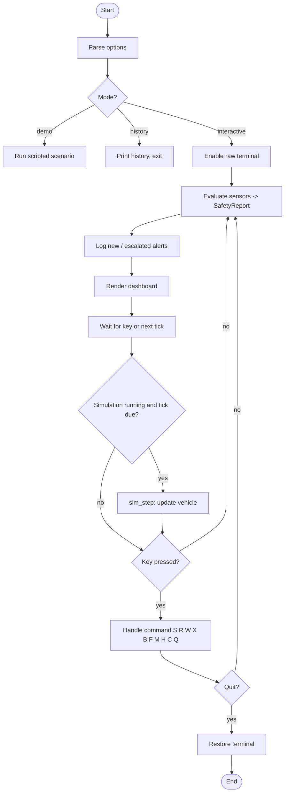
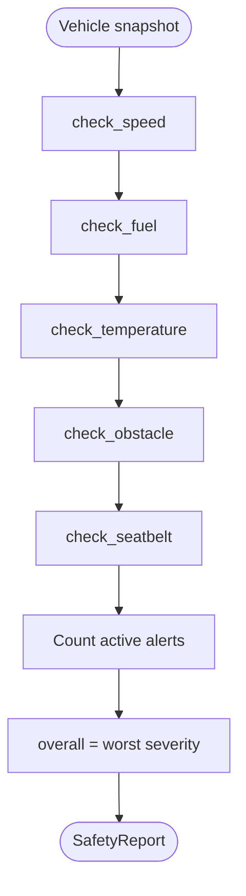
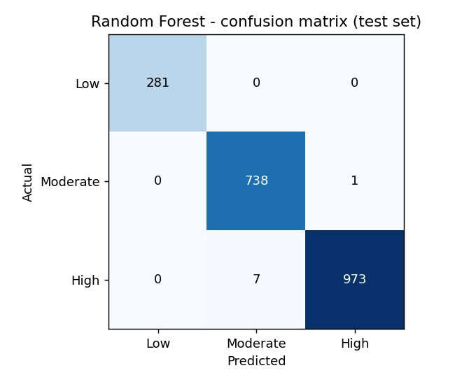
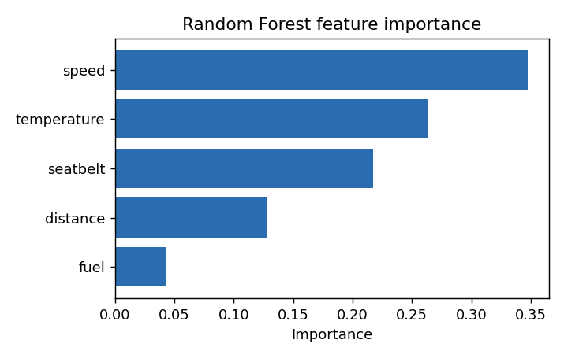

# Smart Vehicle Safety Monitoring System with ML-Based Risk Prediction

*(C on Linux, extended with a Python / scikit-learn risk-prediction module)*

**Capstone Project Report**

| | |
|---|---|
| Student name | _[your name]_ |
| Roll / enrolment no. | _[your number]_ |
| Programme / batch | _[programme, batch]_ |
| Guide / mentor | _[mentor name]_ |
| Institution | _[institution]_ |
| Date of submission | _[date]_ |

---

## Table of contents

1. Abstract
2. Introduction
3. Problem statement and objectives
4. Scope and constraints
5. Requirements
6. System design
7. Module description
8. Data structures
9. Algorithms and safety rules
10. Simulation model
11. Alert history (file handling)
12. Build system (Makefile)
13. Implementation notes
14. Testing
15. Results
16. User manual
17. Limitations
18. Future scope
19. Conclusion
20. References
21. Appendix: source file inventory

**Part II - ML extension**

22. Machine-learning risk prediction module (dataset, preprocessing, algorithm, metrics, C integration)
23. Linux implementation and demonstration
24. Testing and validation (extended)
25. Screenshots and captured output

---

## 1. Abstract

Road-vehicle safety depends on the driver being told about dangerous conditions
quickly and clearly. This project implements a **Smart Vehicle Safety Monitoring and
Dashboard System** in the C language for Linux. A simulated vehicle produces five
sensor readings — speed, fuel level, engine temperature, obstacle distance and
seatbelt status. A rule engine evaluates them against configurable thresholds and
classifies the overall situation as **Safe, Warning or Critical**. A colour text-mode
dashboard displays all parameters in real time, several alerts can be active at the same
time, the user can start, stop and reset the simulation, and every alert is stored in a
history file. The program is built with GCC and a Makefile, uses only standard C and
POSIX libraries, and is covered by automated unit tests that also pass under
AddressSanitizer and UndefinedBehaviorSanitizer.

The system is extended with a **machine-learning risk-prediction module** (Python,
scikit-learn). A Random Forest trained on a 10,000-row labelled telemetry dataset
predicts an overall risk level — **Low, Moderate or High** — from the same five
parameters (test accuracy 99.6 %, macro F1 0.997). The C program calls the model through a
pipe-based bridge and shows the prediction on the dashboard in a panel that is
**separate from the rule-based alerts**; if Python is unavailable the rule-based system
keeps working unchanged. Part II (sections 22 to 25) documents the dataset, the model,
the Linux demonstration and the extended test results.

## 2. Introduction

Modern cars contain many sensors and an instrument cluster that gathers their values.
Two related ideas are combined here:

1. **Car Safety Monitoring System** – detects unsafe conditions (overspeed, low fuel,
   overheating, close obstacles, unfastened seatbelt) and raises alerts.
2. **Car Dashboard Display Simulation** – presents the vehicle's parameters on a
   digital instrument panel.

Merging them produces a more realistic system: the dashboard is not only a display,
it also reflects the safety state computed by the monitoring logic.

## 3. Problem statement and objectives

**Problem statement.** Design and implement, in C on Linux, a program that simulates
a vehicle, continuously monitors its safety-critical parameters, displays them on a
digital dashboard, warns the driver of multiple simultaneous hazards, and keeps a
permanent record of those warnings.

**Objectives**

* Implement monitoring for speed, fuel, temperature, obstacle distance and seatbelt.
* Classify the system as Safe, Warning or Critical.
* Support multiple simultaneous alerts.
* Provide a live, readable digital dashboard in the terminal.
* Provide Start, Stop and Reset simulation controls.
* Store alert history in a file and allow it to be viewed.
* Use a modular design, GCC and a Makefile; keep the code warning-free and tested.

**Objectives of the ML extension (Part II)**

* Build and document a labelled vehicle-telemetry dataset (CSV) and preprocess it.
* Train and evaluate a Random Forest classifier (Low / Moderate / High risk) with
  accuracy, precision, recall, F1-score and a confusion matrix.
* Integrate the Python model with the C application and show the prediction on the
  existing dashboard, keeping rule-based alerts and ML predictions separate.
* Demonstrate the whole system on Linux (GCC, Makefile, shell, file handling, debugging).
* Test all alerts, simultaneous alerts, ML scenarios and invalid input.

## 4. Scope and constraints

| In scope | Out of scope |
|---|---|
| Single simulated vehicle and single driver | Real CAN-bus / hardware sensors |
| Terminal (ANSI) user interface | Graphical (GUI) interface |
| Linux / POSIX systems | Windows-native build |
| Text-file alert history | Database storage |

## 5. Requirements

### 5.1 Functional requirements

| ID | Requirement |
|---|---|
| FR-1 | The system shall accept/simulate vehicle speed and flag overspeed. |
| FR-2 | The system shall track fuel percentage and flag low fuel. |
| FR-3 | The system shall track engine temperature and flag overheating. |
| FR-4 | The system shall accept/simulate obstacle distance and flag proximity. |
| FR-5 | The system shall track seatbelt status and flag an unfastened belt while moving. |
| FR-6 | The system shall display all parameters on a digital dashboard. |
| FR-7 | The system shall report an overall status of Safe, Warning or Critical. |
| FR-8 | The system shall show all active alerts simultaneously. |
| FR-9 | The user shall be able to start, stop and reset the simulation. |
| FR-10 | Every new or escalated alert shall be appended to a history file. |
| FR-11 | The user shall be able to view and clear the alert history. |
| FR-12 | The user shall be able to enter sensor values manually. |

### 5.2 Non-functional requirements

| ID | Requirement |
|---|---|
| NFR-1 | Written in C11, compiled with GCC with `-Wall -Wextra -Wpedantic` and zero warnings. |
| NFR-2 | Only standard C and POSIX libraries (no third-party dependencies). |
| NFR-3 | The terminal must always be restored, including on Ctrl+C. |
| NFR-4 | Thresholds must be changeable in one place. |
| NFR-5 | Memory-safe: clean under AddressSanitizer / UBSan. |

### 5.3 Software and hardware environment

| Item | Detail |
|---|---|
| Operating system | Linux (developed and tested on Ubuntu) |
| Compiler | GCC 15.2 (C11) |
| Build tool | GNU Make 4.4 |
| Libraries | libc, POSIX `termios`, `select`, `sys/stat`, `fork`/`pipe`/`poll` (ML bridge) |
| ML runtime (optional) | Python 3.9+, scikit-learn, pandas, numpy, joblib, matplotlib (`ml/requirements.txt`) |
| Terminal | ANSI-capable, ≥ 64 columns × 46 rows (60 rows for the roomy layout; compact layout is automatic) |

## 6. System design

### 6.1 Architecture

The program is split into layers so that each module has one responsibility and the
rule engine has no knowledge of the screen or the keyboard (this is what makes it
easy to unit-test).

```
                       +---------------------------+
                       |          main.c           |
                       |  CLI, event loop, demo    |
                       +-------------+-------------+
          keys                       |                          output
   +----------------+                |               +--------------------+
   |  terminal.c    |<---------------+-------------->|    dashboard.c     |
   | raw input      |                |               |   ANSI rendering   |
   +----------------+                |               +---------^----------+
                                     v                         |
   +----------------+      +-----------------+      +-----------+--------+
   | simulation.c   |----->|    vehicle.h    |----->|     monitor.c      |
   | physics model  |      |  Vehicle state  |      |  rules -> alerts   |
   +----------------+      +-----------------+      +-----------+--------+
                                                                |
                                                    +-----------v--------+
                                                    |     logger.c       |
                                                    | alert_history.log  |
                                                    +--------------------+
```

**ML extension.** The ML predictor is added beside the rule engine, not inside it: see
the block diagram in section 22.6. The rule engine still has no knowledge of the ML
module, and the ML module never changes a `SafetyReport`.

### 6.2 Main-loop flowchart



### 6.3 Safety-evaluation flowchart



All five checkers always run, which is why several alerts can be active together.

### 6.4 Alert-logging state logic

To avoid writing the same line every second, the logger compares the *previous* and
*current* report for each alert type:

| Previous | Current | Logged? |
|---|---|---|
| inactive | active | yes — new alert |
| Warning | Critical | yes — escalation |
| active | same level | no |
| Critical | Warning | no — de-escalation |
| active | inactive | no — cleared |

## 7. Module description

| Module | Files | Responsibility |
|---|---|---|
| Configuration | `config.h` | Thresholds, limits, file paths, simulation constants |
| Vehicle model | `vehicle.h/.c` | `Vehicle` structure; reset and clamping to valid ranges |
| Monitor | `monitor.h/.c` | Five sensor checkers; produces `SafetyReport` |
| Simulation | `simulation.h/.c` | Physics-lite model; driver inputs (accelerate, brake, belt, refuel) |
| Dashboard | `dashboard.h/.c` | Fixed-layout ANSI panel with bars, colours and alert list |
| Logger | `logger.h/.c` | Append, view-last-N and clear of the history file |
| Terminal | `terminal.h/.c` | Raw mode, non-blocking `select()` input, safe restore |
| Platform | `platform.h/.c` | Portability layer: Winsock + UTF-8/ANSI console on Windows, POSIX clock/mkdir/browser elsewhere |
| Server | `server.h/.c` | Single-threaded HTTP server (POSIX sockets): static files + JSON API for the web dashboard |
| Main | `main.c` | Options, interactive loop, manual input, demo scenario, `--serve` entry |
| Web front end | `web/index.html, style.css, app.js` | Browser display and controls; no logic of its own, talks to the C server |

## 8. Data structures

```c
typedef struct {
    float speed_kmh, fuel_pct, engine_temp_c, obstacle_m;
    bool  seatbelt_fastened;
    float target_speed_kmh, odometer_km;
    unsigned long ticks;
    SimState state;                  /* SIM_STOPPED | SIM_RUNNING */
} Vehicle;

typedef enum { LEVEL_SAFE, LEVEL_WARNING, LEVEL_CRITICAL } Severity;
typedef enum { ALERT_OVERSPEED, ALERT_LOW_FUEL, ALERT_OVERHEAT,
               ALERT_OBSTACLE, ALERT_SEATBELT, ALERT_COUNT } AlertType;

typedef struct { bool active; Severity level; char message[96]; } Alert;

typedef struct {
    Alert    alerts[ALERT_COUNT];    /* indexed by AlertType */
    int      active_count;
    Severity overall;
} SafetyReport;
```

Indexing `alerts[]` by the `AlertType` enum gives O(1) access and makes
"multiple simultaneous warnings" natural: each type has its own slot.

## 9. Algorithms and safety rules

### 9.1 Threshold table

| Parameter | Safe | Warning | Critical |
|---|---|---|---|
| Speed | ≤ 80 km/h | > 80 km/h | > 120 km/h |
| Fuel | ≥ 15 % | < 15 % | < 5 % |
| Engine temperature | ≤ 100 °C | > 100 °C | > 110 °C |
| Obstacle distance | ≥ 10 m | < 10 m | < 3 m |
| Seatbelt | fastened, or vehicle stationary | unfastened, speed ≤ 40 km/h | unfastened, speed > 40 km/h |

Boundaries are strict (a speed of exactly 80 km/h is *not* overspeed); this is verified
by unit tests.

### 9.2 Overall status

```
overall = max( severity of every active alert )     /* SAFE if none */
```

### 9.3 Seatbelt rule

A parked vehicle with an open belt is not a hazard, so the seatbelt alert is raised
only when speed > 0. It becomes Critical above 40 km/h.

## 10. Simulation model

One tick represents one second.

| Quantity | Model |
|---|---|
| Speed | Ramps toward the driver's target; max +8 km/h per tick, −12 km/h per tick braking; ±0.5 km/h jitter while cruising |
| Fuel | `−(0.05 + 0.01 × speed)` % per tick; engine stops (speed → 0) at 0 % |
| Engine temperature | Relaxes 10 % per tick toward `60 + 0.45 × speed` °C, plus ±0.4 °C noise |
| Obstacle | Random walk ±6 m, closing at `0.05 × speed` m per tick; respawns 100–200 m ahead when passed |
| Odometer | `+ speed / 3600` km per tick |

Fuel use is **intentionally accelerated** (about 100 s of driving at 100 km/h empties
the tank) so low-fuel behaviour can be demonstrated during a short viva or demo.

## 11. Alert history (file handling)

* File: `logs/alert_history.log` (directory created automatically with `mkdir`).
* Opened in append mode for each record, so data survives a crash.
* Record format:

```
[2026-11-18 13:30:40] [CRITICAL] SEATBELT : SEATBELT OFF at 130 km/h (>40) | spd=130 fuel=8.4 temp=103 obst=96.6 belt=OFF
```

* Viewing the last *N* lines uses a circular buffer of *N* lines, so memory stays
  constant however large the file is.
* C library functions used: `fopen`, `fprintf`, `fgets`, `fclose`, `strftime`,
  `localtime`, `mkdir`.

## 12. Build system (Makefile)

| Target | Action |
|---|---|
| `make` | Compile every `src/*.c` to `build/*.o` and link `build/svsm` |
| `make run` | Build, then launch the interactive dashboard |
| `make demo` | Build, then run a seeded 40-second scenario |
| `make serve` | Build, then start the C backend and web dashboard on `http://localhost:8080` |
| `make test` | Build and run the unit tests (`tests/test_monitor.c`) |
| `make dist` | Cross-build `dist/svsm.exe` (MinGW-w64, static) and `dist/svsm-linux-x64` (static) so the project runs on laptops with no compiler |
| `make test-api` | Build, start the server and test every HTTP endpoint with `curl` (`tests/test_api.sh`) |
| `make debug` | Clean rebuild + tests with `-g -O0 -fsanitize=address,undefined` |
| `make history` | Print the last 20 history records |
| `make clean` / `distclean` | Remove `build/` (and `logs/`) |
| `make help` | List targets |

Features: automatic header dependency tracking (`-MMD -MP`), out-of-source object
files, wildcard source discovery (adding a `.c` file needs no Makefile edit), and
`-Wall -Wextra -Wpedantic` on every build.

## 13. Implementation notes

* **Non-blocking input.** `termios` disables canonical mode and echo; `select()` waits
  for a key *or* for the next simulation tick, so the dashboard updates every second
  yet reacts instantly to key presses without threads.
* **Safe terminal restore.** `atexit()` and SIGINT/SIGTERM handlers restore the original
  terminal settings, so Ctrl+C never leaves the shell in raw mode.
* **Flicker-free redraw.** The dashboard uses cursor-home plus erase-to-end-of-line
  rather than clearing the screen on every frame; the alert area has fixed height so the
  panel never jumps.
* **Alignment with colour.** Colour escape codes are printed outside `printf` width
  specifiers so column widths are never disturbed.
* **Separation of concerns.** The rule engine takes a `const Vehicle *` and returns data;
  it never prints. The same code serves the dashboard, the logger and the tests.
* **Input validation.** Manual input is parsed with `strtof`, checked for trailing
  characters and range, and ignored (keeping the old value) when invalid.

## 14. Testing

### 14.1 Strategy

* **Unit tests** (`make test`) exercise the rule engine, simulator and logger directly
  without a terminal.
* **Sanitizer run** (`make debug`) repeats them with AddressSanitizer and UBSan.
* **API integration tests** (`make test-api`) start the real server and exercise every endpoint with `curl` (24 checks: commands, alerts, log file contents, CSV export, static files, 404s, path-traversal rejection).
* **Scripted demo** (`make demo`) is a seeded, repeatable end-to-end scenario.
* **Interactive test** — keys driven through a pseudo-terminal to confirm start,
  accelerate, history, manual input and quit work end to end.

### 14.2 Unit-test cases (27 checks, all passing)

| # | Area | Case | Expected |
|---|---|---|---|
| 1 | Safe | Healthy belted vehicle | 0 alerts, SAFE |
| 2 | Speed | Exactly 80 km/h | No alert |
| 3 | Speed | 81 km/h | WARNING |
| 4 | Speed | 121 km/h | CRITICAL |
| 5 | Fuel | 14.9 % | WARNING |
| 6 | Fuel | 4.9 % | CRITICAL |
| 7 | Fuel | 15.0 % | No alert |
| 8 | Temp | 105 °C | WARNING |
| 9 | Temp | 115 °C | CRITICAL |
| 10 | Obstacle | 8 m | WARNING |
| 11 | Obstacle | 2 m | CRITICAL |
| 12 | Seatbelt | Open, parked | No alert |
| 13 | Seatbelt | Open, 20 km/h | WARNING |
| 14 | Seatbelt | Open, 60 km/h | CRITICAL |
| 15 | Multi-alert | All five faults at once | 5 active alerts |
| 16 | Multi-alert | Same case | Overall CRITICAL |
| 17 | Simulation | Step while stopped | Ignored (ticks = 0) |
| 18 | Simulation | Target 10 km/h for 20 ticks | Speed converges near 10 |
| 19 | Simulation | Driving | Fuel decreases |
| 20 | Simulation | 20 steps | Tick counter = 20 |
| 21 | Simulation | Empty tank, target 100 | Vehicle stops |
| 22 | Simulation | Reset | Defaults restored |
| 23 | Logger | Open log file | Success |
| 24 | Logger | New alert | 1 record |
| 25 | Logger | Unchanged alert | 0 records |
| 26 | Logger | Escalation | 1 record |
| 27 | Logger | Read back | 2 records |

### 14.3 System-level test scenarios

| Scenario | Steps | Expected result |
|---|---|---|
| Overspeed | `B`, `S`, press `W` until > 80 km/h | Speed row WARNING, alert listed, logged |
| Critical overspeed | Keep accelerating beyond 120 | Status CRITICAL |
| Unbelted driving | Start, accelerate, do not press `B` | Seatbelt alert; Critical above 40 km/h |
| Low fuel | Drive fast for ~1 minute | Fuel Warning then Critical |
| Overheat | Hold 130+ km/h | Temperature Warning then Critical |
| Proximity | `M`, enter obstacle 2 m | Obstacle CRITICAL, collision-risk message |
| Multiple alerts | `M`: speed 150, fuel 10, temp 112, obstacle 2, belt n | Five alerts, overall CRITICAL |
| Stop / Reset | `S` stops clock; `R` restores defaults | Dashboard reflects state |
| History | `H`, then `C` | Records shown; file emptied |
| Ctrl+C | Press during run | Terminal restored, message printed |

## 15. Results

The system met every functional requirement. A representative dashboard (manual input of
150 km/h, 112 °C, belt off) is shown below, and the history file correctly contained
one record per new or escalated alert.

```
+-----------------------------------------------------------+
|          SMART VEHICLE SAFETY & DASHBOARD SYSTEM          |
+-----------------------------------------------------------+
| SIM: RUNNING   TIME: 00:00:04  ODO: 0.06 km               |
+-----------------------------------------------------------+
| Speed        150 km/h    [###################.] CRITICAL  |
| Fuel         48.4 %      [##########..........] OK        |
| Engine Temp  113 C       [################....] CRITICAL  |
| Obstacle     155.9 m     [################....] OK        |
| Seatbelt     UNFASTENED                         CRITICAL  |
+-----------------------------------------------------------+
| SAFETY STATUS : [ CRITICAL ]   active alerts: 3           |
+-----------------------------------------------------------+
| ! [CRITICAL] OVERSPEED 150 km/h (limit 80)                |
| ! [CRITICAL] ENGINE OVERHEAT 113 C (max 110)              |
| ! [CRITICAL] SEATBELT OFF at 150 km/h (>40)               |
+-----------------------------------------------------------+
```

| Measure | Result |
|---|---|
| Compiler warnings (`-Wall -Wextra -Wpedantic`) | 0 |
| Unit checks | 27 / 27 passed |
| AddressSanitizer / UBSan | No errors |
| Source size | ≈ 1 200 lines of C across 7 source files and 7 headers (plus tests) |

## 16. User manual

1. **Install tools:** `sudo apt install build-essential`
2. **Build:** `make`
3. **Run:** `make run` (or `./build/svsm`)
4. **Drive:** `B` fasten belt → `S` start → `W` to accelerate, `X` to brake.
5. **Observe:** each row turns green / yellow / red; alerts list below the status line.
6. **Manual mode:** `M`, then type values or press Enter to keep the current one.
7. **History:** `H` to view, `C` to clear; outside the program use `make history`.
8. **Quit:** `Q` or Ctrl+C.

Run `./build/svsm --help` for command-line options.

## 17. Limitations

* Sensors are simulated; there is no real hardware or CAN-bus interface.
* Linux/POSIX only because of `termios` and `select()`.
* Text-mode UI; terminal must be at least 74 columns wide.
* Fuel consumption is accelerated for demonstration, not physically accurate.
* Obstacle alerts are distance-based only; relative speed (time-to-collision) is not used.
* History is a plain text file without rotation.
* The ML model was trained on a dataset whose labels follow the same thresholds as the rule
  engine (section 22.2). Its 99.6 % accuracy therefore shows that the model has learned
  the labelling rule; it is **not** evidence of real-world crash-prediction ability. The
  data is synthetic/simulated, covers speed up to 160 km/h, temperature 70-125 °C and
  obstacle distance up to 50 m, and the simulator can go beyond that.
* Obstacle distance is a single reading; no relative speed or time-to-collision is used by
  the model either.
* The ML bridge needs Python with scikit-learn on the machine; the bundled `dist/` binaries
  and the Docker image do not include Python, so there the ML panel shows "unavailable".
* The model is trained offline; it does not learn from the running simulation.

### 17.1 Web dashboard (C backend + browser front end)

Besides the terminal interface, the same C program can serve a browser dashboard (`svsm --serve`). `server.c`
implements a small single-threaded HTTP server with POSIX sockets: one `select()` loop waits for either an incoming
request or the next simulation tick, so no threads or locks are needed. The browser page (`web/`) holds **no
simulation or safety logic**; it polls `GET /api/state` and sends commands with `GET /api/cmd?a=...`. Every
reading, alert message, trip statistic and history record is produced by `simulation.c`, `monitor.c` and
`logger.c`, the same modules used by the terminal version, and history is read back from the real
`alert_history.log` file.

| Endpoint | Purpose |
|---|---|
| `/` and static files | dashboard files from `web/` |
| `/api/state` | readings, trip statistics, safety report (JSON) |
| `/api/cmd?a=...` | start, stop, reset, demo, accel, brake, refuel, target, belt, manual, rate, set, clear |
| `/api/history?n=` | alert history, newest first |
| `/api/export.log`, `/api/export.csv` | download the log file / CSV |

Portability: the same sources build on Linux, macOS and Windows. `platform.c` hides the differences (Winsock start-up, UTF-8/ANSI console, monotonic clock, `mkdir`, opening the default browser); `terminal.c` uses `termios` on Unix and `conio` on Windows. On Windows the program was verified natively (terminal dashboard, HTTP API, history parsing, port fallback). If the chosen port is busy the server tries the next 19.

Security notes: the server binds to `127.0.0.1` by default, accepts `GET` only, rejects any path containing `..`,
bounds every buffer, and ignores idle pre-connections with a receive timeout.

The browser UI itself is a single-screen layout (no page scrolling): sensor cards with sparklines, a tabbed
Alerts / History / Manual / Guide panel, a controls column, a detail window with a 60-sample chart, light/dark
themes, and a bottom navigation bar on phones.

## 18. Future scope

* Real data source: read sensors via serial port or OBD-II / CAN (SocketCAN).
* Time-to-collision using closing speed, and graded braking advice.
* Tyre pressure, door status, battery voltage and lane-departure modules.
* Audible alarm (terminal bell / ALSA) and blinking critical alerts.
* Log rotation and CSV export for analytics; SQLite storage.
* `ncurses` or GTK/SDL graphical gauges; configuration file for thresholds.
* ML: train on real telemetry (OBD-II logs), add relative speed / time-to-collision as features, compare Gradient Boosting, export the model to ONNX or C for a Python-free build.
* Multi-threaded sensor acquisition and a client–server telemetry mode.

## 19. Conclusion

The project delivers a complete, modular, tested safety-monitoring and dashboard
application in C for Linux. It demonstrates structured programming, enumerations and
structures, file handling, POSIX terminal control, separation of logic from presentation,
automated testing and a professional Makefile build. Because all thresholds are
centralised and the rule engine is independent of the user interface, the system can be
extended to real sensors or new safety checks with small, local changes.

The ML extension adds a second, complementary view of the same data: a Random Forest
that judges the *combined* risk (Low / Moderate / High) and reaches 99.6 % accuracy,
0.997 macro F1 and no High-to-Low confusion on the held-out test set. It is integrated
with the C program through a small pipe protocol, shown in its own dashboard panel,
and designed to fail safe: if the ML part is unavailable the rule-based monitor works
exactly as before. Together with the Linux demonstration (GCC, Makefile, shell scripts,
file handling, sanitizer debugging) and 138 automated checks (46 C unit, 25 Python,
41 integration, 26 API), the project meets the updated capstone guidelines.
Its main limitation is that the dataset is simulated and rule-labelled, so the next step
is training on real vehicle telemetry.

## 20. References

1. B. W. Kernighan and D. M. Ritchie, *The C Programming Language*, 2nd ed., Prentice Hall.
2. ISO/IEC 9899:2011, *Programming languages — C*.
3. M. Kerrisk, *The Linux Programming Interface*, No Starch Press, 2010.
4. GNU Make Manual — <https://www.gnu.org/software/make/manual/>
5. GCC Manual — <https://gcc.gnu.org/onlinedocs/>
6. `termios(3)`, `select(2)`, `mkdir(2)` — Linux man-pages.
7. ECMA-48 / ANSI escape code reference for terminal control sequences.

## 21. Appendix: source file inventory

| File | Purpose |
|---|---|
| `include/config.h` | Thresholds and constants |
| `include/vehicle.h`, `src/vehicle.c` | Vehicle state, reset, clamp |
| `include/monitor.h`, `src/monitor.c` | Rule engine |
| `include/simulation.h`, `src/simulation.c` | Simulator and driver inputs |
| `include/dashboard.h`, `src/dashboard.c` | ANSI dashboard |
| `include/logger.h`, `src/logger.c` | Alert history file |
| `include/terminal.h`, `src/terminal.c` | Raw keyboard input |
| `src/main.c` | Program entry and control loop |
| `tests/test_monitor.c` | Unit tests |
| `Makefile` | Build automation |
| `include/ml.h`, `src/ml.c` | C <-> Python bridge (process, pipes, text protocol) |
| `ml/predict.py` | Predictor service / command line (loads the model) |
| `ml/train_model.py` | Preprocessing, feature selection, training, evaluation |
| `ml/analyze_labels.py` | Explains how labels relate to the safety thresholds |
| `ml/data/vehicle_risk_dataset.csv` | Labelled telemetry dataset (10,000 rows) |
| `ml/model/risk_model.joblib` | Trained Random Forest |
| `ml/reports/` | Metrics (JSON/Markdown), confusion matrix, feature importance, label analysis |
| `tests/test_ml.py`, `tests/test_ml_integration.sh` | ML and C <-> Python tests |
| `scripts/linux_demo.sh` | Scripted Linux demonstration |

---

## 22. Machine-learning risk prediction module

### 22.1 Objective

The rule engine of sections 7 to 9 reacts to **one sensor at a time**: it can say "speed
is above 80" or "the seatbelt is off", but it does not judge the *combined* situation.
The ML module adds that second opinion. A Random Forest classifier reads all five
parameters together (speed, engine temperature, fuel, obstacle distance, seatbelt)
and predicts an overall **risk level: Low, Moderate or High**.

The two parts are kept **separate on purpose**:

| | Rule-based monitor (`monitor.c`) | ML predictor (`ml/`, `ml.c`) |
|---|---|---|
| Output | Safe / Warning / Critical + one alert per sensor | Low / Moderate / High + confidence |
| Logic | Fixed thresholds from `config.h` | Learned from 10,000 labelled samples |
| Written to alert history | Yes | No |
| Needs Python | No | Yes |
| If the other part fails | Unaffected | Dashboard shows "unavailable" |

### 22.2 Dataset

| Item | Value |
|---|---|
| File | `ml/data/vehicle_risk_dataset.csv` (the project's own dataset) |
| Rows | 10,000 (no missing values, no out-of-range values, no duplicates) |
| Columns | `speed` (km/h), `temperature` (°C), `fuel` (%), `distance` (m, to obstacle), `seatbelt` (1 = fastened, 0 = not), `risk` (label) |
| Observed ranges | speed 0–160, temperature 70–125, fuel 0–100, distance 0.5–50, seatbelt 0/1 |
| Class balance | Low 1,402 (14.0 %), Moderate 3,696 (37.0 %), High 4,902 (49.0 %) |

**How the risk labels are assigned.** The labelling script is not stored with the CSV,
so the labelling was analysed empirically (`python ml/analyze_labels.py`, output in
`ml/reports/label_analysis.md`). The labels follow the **same thresholds as the C
rule engine** (`config.h`): the speed limits 80 / 120 km/h, engine temperature 100 / 110 °C,
fuel 15 / 5 %, obstacle 10 / 3 m, and the seatbelt rule. If every sensor contributes
1 point for a *Warning* and 2 points for a *Critical* reading (seatbelt: 1 point below
40 km/h, 2 points above while moving), the labels fall into three bands:

| Severity points | Low | Moderate | High |
|---|---|---|---|
| 0 | 1,009 | 0 | 0 |
| 1 | 366 | 1,234 | 0 |
| 2 | 27 | 2,047 | 108 |
| 3 | 0 | 394 | 1,495 |
| 4 | 0 | 21 | 1,701 |
| 5 or more | 0 | 0 | 1,598 |

In words: **no alerts → Low; one or two minor alerts → Moderate; three or more points,
or a severe combination such as speed above 80 km/h with no seatbelt → High.** The bands
overlap slightly at the boundaries (for example 2 points can be Moderate or High), so the
label is not a perfect function of the points. That is why a learned model is useful
and why a small number of test errors remain (section 22.5).

> **Limitation of the data.** The CSV covers speed up to 160 km/h, temperature
> 70–125 °C and obstacle distance up to 50 m, whereas the C simulator can produce
> 220 km/h, a cold engine (25 °C) and obstacles up to 200 m. Tree models treat values
> beyond the training range like the nearest edge value, so predictions there are
> plausible but have not been validated.

### 22.3 Preprocessing and feature selection

Implemented in `ml/train_model.py`:

1. **Validation** — required columns present; label text normalised; rows with missing
   values, unknown labels or physically impossible readings (outside the ranges of
   `config.h`) are dropped. For this dataset nothing needed to be dropped.
2. **Type handling** — `seatbelt` converted to integer 0/1.
3. **Feature selection** — three independent rankings are computed on the full data:

| Feature | RF importance | Mutual information | Correlation with risk |
|---|---|---|---|
| speed | 0.348 | 0.191 | +0.528 |
| temperature | 0.264 | 0.124 | +0.390 |
| seatbelt | 0.217 | 0.108 | −0.432 |
| distance | 0.128 | 0.046 | −0.181 |
| fuel | 0.043 | 0.016 | −0.063 |

   All five features are **kept**: each one is a sensor of the C system and has a
   non-zero effect (fuel is weakest because low fuel is only a Warning-level hazard).
   No scaling is needed because tree-based models are insensitive to feature scale.
4. **Train / test split** — stratified 80 / 20 (8,000 training rows, 2,000 test rows,
   `random_state = 42`), so each class has the same share in both sets. The test set
   is used only once, for the final evaluation.

### 22.4 Algorithm and methodology

* **Baseline:** Decision Tree (`max_depth = 10`).
* **Selected model:** Random Forest (`n_estimators = 200`, `max_depth = 14`,
  `min_samples_leaf = 2`). A Random Forest averages many decision trees trained on random
  subsets of the data and features, which reduces over-fitting and gives class
  probabilities that are used as the *confidence* shown on the dashboard.
* **Validation:** 5-fold stratified cross-validation on the training set, then a single
  evaluation on the held-out test set.
* **Saved artefact:** `ml/model/risk_model.joblib` (model + feature order + valid ranges +
  scikit-learn version). Retrain with `make ml-train`.

### 22.5 Model performance

Held-out test set, 2,000 rows (`ml/reports/metrics.md`, `metrics.json`):

| Model | Accuracy | Precision (macro) | Recall (macro) | F1 (macro) | 5-fold CV accuracy |
|---|---|---|---|---|---|
| Decision Tree (baseline) | 0.9960 | 0.9966 | 0.9971 | 0.9968 | 0.9980 ± 0.0009 |
| **Random Forest (selected)** | **0.9960** | **0.9965** | **0.9972** | **0.9968** | 0.9970 ± 0.0012 |

Per class (Random Forest):

| Class | Precision | Recall | F1 | Support |
|---|---|---|---|---|
| Low | 1.0000 | 1.0000 | 1.0000 | 281 |
| Moderate | 0.9906 | 0.9986 | 0.9946 | 739 |
| High | 0.9990 | 0.9929 | 0.9959 | 980 |

Confusion matrix (rows = actual, columns = predicted); figure: `ml/reports/confusion_matrix.png`

| | pred Low | pred Moderate | pred High |
|---|---|---|---|
| **actual Low** | 281 | 0 | 0 |
| **actual Moderate** | 0 | 738 | 1 |
| **actual High** | 0 | 7 | 973 |




**Interpretation.** Of 2,000 test rows only 8 are wrong, and every error is between
*neighbouring* classes (Moderate ↔ High); no High case was ever predicted Low. The
Decision Tree baseline scores the same, which shows that the labels are almost
rule-like (section 22.2). The accuracy therefore measures how well the model reproduces
the **dataset's labelling rule**, not real-world crash risk — see the limitations in
section 17.

### 22.6 Integration with the C application

```
 +-----------------+   Vehicle   +---------------------+        +--------------------+
 |  simulation.c   |------------>|     monitor.c       |------->|    dashboard.c     |
 |  (sensors)      |      |      |  rule-based alerts  |        |  rules panel       |
 +-----------------+      |      +---------------------+        |  + ML panel (own   |
                          |                  |                  |    row, own colour)|
                          |                  v                  +----------^---------+
                          |          +--------------+                      |
                          |          |   logger.c   |                      |
                          |          | alert history|                      |
                          |          +--------------+                      |
                          |      +---------------------+                   |
                          +----->|       ml.c          |-------------------+
                                 |  C <-> Python bridge|
                                 +---------+-----------+
                          stdin  "speed temp fuel dist belt"  |  stdout "OK High 0.97 ..."
                                 +---------v-----------+
                                 |  ml/predict.py      |   (child process, started once)
                                 |  Random Forest model|   ml/model/risk_model.joblib
                                 +---------------------+
```

* `ml_start()` launches `python3 ml/predict.py --serve` with `fork()` / `execlp()` and two
  pipes (on Windows `CreateProcess` with anonymous pipes). Python loads the model once and
  answers one line per request, so the cost per prediction is a pipe round-trip (a few
  milliseconds) instead of starting Python every second.
* The protocol is plain text: request `speed temperature fuel distance seatbelt`, reply
  `OK <Low|Moderate|High> <confidence> <p_low> <p_moderate> <p_high>` or `ERR <reason>`.
* **Separation:** `ml.c` never includes `monitor.h`; `monitor.c` never calls `ml.c`.
  `main.c` and `server.c` call both independently and `dashboard.c` draws them in two
  separate panels. ML predictions are **not** written to the alert history.
* **Error handling:** inputs are validated twice (in C and in Python); the reply is parsed
  strictly; a 2-second timeout protects against a hung predictor; if Python, scikit-learn
  or the model is missing the program prints one line (`ML disabled: ...`) and continues
  with rule-based monitoring only.
* **Where it shows:** terminal dashboard (new row "ML RISK PREDICTION [ High ] conf 97 %
  L / M / H probabilities"), web dashboard (coloured "ML risk" chip in the status banner,
  `ml` object in `/api/state`), and the command line (`svsm --predict S T F D B`).
* **Options:** `--no-ml`, `--ml-python CMD`, `--ml-script FILE`; environment variables
  `SVSM_PYTHON`, `SVSM_ML_SCRIPT`, `SVSM_MODEL`.

### 22.7 Reproducing the ML work

```sh
make ml-setup                    # pip install -r ml/requirements.txt
python3 ml/analyze_labels.py     # how the labels relate to the safety thresholds
make ml-train                    # preprocess, split, train, evaluate, save model + reports
python3 ml/predict.py 150 113 3 2 0      # one prediction (Python only)
./build/svsm --predict 150 113 3 2 0     # same through the C program
make run                         # dashboard with the ML panel
```

---

## 23. Linux implementation and demonstration

Everything is driven by `make` and the shell script `scripts/linux_demo.sh`
(`make linux-demo`), which prints each command before running it. A transcript is kept in
`docs/evidence/linux_demo.txt`.

| Topic | What is demonstrated | Commands |
|---|---|---|
| GCC compilation | Manual build and warning-free strict build | `gcc -std=c11 -Wall -Wextra -Wpedantic -O2 -Iinclude -D_POSIX_C_SOURCE=200809L src/*.c -o build/svsm` |
| Makefile | Incremental build, dependency files, targets for run / demo / test / ML | `make`, `make run`, `make demo`, `make ml-train`, `make test-all`, `make help`, `make clean` |
| Terminal commands | Environment and project inspection | `uname -srm`, `gcc --version`, `ls`, `find`, `wc -l`, `file`, `ps`, `pgrep`, `kill` |
| File handling | Dataset and alert-log analysis; C file I/O in `logger.c`; model/report files | `head`, `tail`, `cut -d, -f6 \| sort \| uniq -c`, `awk -F,`, `grep -c CRITICAL`, `svsm --history 5` |
| Shell scripting | Scenario loop with `while read`, exit-code checks, background server with `trap` clean-up | `scripts/linux_demo.sh`, `tests/test_ml_integration.sh`, `tests/test_api.sh` |
| Execution | Interactive dashboard, 40-second scripted demo, HTTP server | `./build/svsm`, `./build/svsm --demo 40 --seed 7`, `./build/svsm --serve 8080` |
| Debugging | AddressSanitizer + UBSan build and test run; process tree of C parent and Python child | `make debug`, `ps -o pid,ppid,cmd --ppid <pid>`, `valgrind -q --leak-check=full ./build/svsm --predict ...` (if installed) |
| C / Python integration | `fork`/`exec`/`pipe`/`poll` bridge, text protocol, timeouts | `./build/svsm --predict 150 113 3 2 0` |

**How the evidence was produced.** The transcript in `docs/evidence/linux_demo.txt` was
generated in Ubuntu under WSL 2 (GCC 15.2.0, GNU Make 4.4.1) with the real Linux C build
(`fork`/`poll` code path). That Ubuntu image had no `pip`, so scikit-learn 1.8.0 was
provided by a Windows Python 3.13 interpreter called from Linux (`SVSM_PYTHON=...python.exe`).
On a normal Linux machine run `make ml-setup && make linux-demo | tee docs/evidence/linux_demo.txt`
to regenerate it with a Linux Python.

---

## 24. Testing and validation (extended)

Four automated suites, all run by `make test-all`:

| Suite | Command | Checks | Result |
|---|---|---|---|
| C unit tests (rule engine, simulator, logger, ML helpers) | `make test` | 46 (27 original + 19 new) | all pass, also under ASan/UBSan (`make debug`) |
| Python tests of the predictor and model | `make ml-test` | 25 | all pass |
| C ↔ Python integration (command line + dashboard + HTTP) | `make test-ml` | 41 | all pass |
| HTTP API of the C backend | `make test-api` | 26 | all pass |

(The Python suite deliberately uses the standard `unittest` runner.)

### 24.1 Rule-based alerts and simultaneous alerts

| ID | Scenario | Expected | Result |
|---|---|---|---|
| T-R1 | Healthy vehicle (60 km/h, 70 % fuel, 85 °C, 80 m, belted) | 0 alerts, SAFE | Pass |
| T-R2 | Speed exactly 80 / 81 / 121 km/h | none / WARNING / CRITICAL | Pass |
| T-R3 | Fuel 14.9 % / 4.9 % / 15 % | WARNING / CRITICAL / none | Pass |
| T-R4 | Temperature 105 °C / 115 °C | WARNING / CRITICAL | Pass |
| T-R5 | Obstacle 8 m / 2 m | WARNING / CRITICAL | Pass |
| T-R6 | Seatbelt off at 0 / 20 / 60 km/h | none / WARNING / CRITICAL | Pass |
| T-R7 | 130 km/h, 10 % fuel, 105 °C, 5 m, no belt | all 5 alerts at once, overall CRITICAL | Pass |
| T-R8 | Same five alerts through the HTTP API | `"count":5` | Pass |

### 24.2 ML predictions for different input scenarios

Command: `./build/svsm --predict SPEED TEMP FUEL DIST BELT` (belt: 1 = fastened).

| ID | Scenario | Input | Expected | Result |
|---|---|---|---|---|
| T-M1 | Safe driving | 50 85 70 40 1 | Low | Low |
| T-M2 | Parked | 0 70 60 30 1 | Low | Low |
| T-M3 | Fast, otherwise fine | 95 85 60 30 1 | Moderate | Moderate |
| T-M4 | Critical fuel only | 50 85 3 40 1 | Moderate | Moderate |
| T-M5 | Overspeed, no seatbelt | 150 85 60 40 0 | High | High |
| T-M6 | Overheating with obstacle at 2 m | 70 115 60 2 1 | High | High |
| T-M7 | All five sensors bad | 150 113 3 2 0 | High | High (100 %) |
| T-M8 | Belt on vs. off, otherwise identical | 60 85 60 40 1 / 0 | different classes | Different |
| T-M9 | Scripted 40-second demo | `--demo 40 --seed 7` | all three classes occur | Low 14, Moderate 14, High 12 frames |
| T-M10 | Probabilities | any | sum to 1, confidence = max | Pass |
| T-M11 | Rules and ML shown independently | demo output | both panels present, alert history unchanged by ML | Pass |
| T-M12 | HTTP: safe vs. dangerous manual input | `/api/cmd?a=set&manual=1&...` | `ml.label` Low vs. High | Pass |

### 24.3 Invalid input and error handling

| ID | Input / condition | Expected behaviour | Result |
|---|---|---|---|
| T-E1 | speed 400, −5; fuel 150; obstacle 999; seatbelt 2 | rejected with message, exit code 2 | Pass |
| T-E2 | non-numeric (`abc`), `nan`, `inf` | rejected, exit code 2 | Pass |
| T-E3 | too few arguments | rejected, exit code 2 | Pass |
| T-E4 | Python interpreter not found | `ML unavailable: cannot run ...`, exit code 3 | Pass |
| T-E5 | predictor script / model file missing | clear message, exit code 3 | Pass |
| T-E6 | Demo with Python missing | prints `ML disabled`, dashboard shows "unavailable", rule alerts still raised, exit 0 | Pass |
| T-E7 | `--no-ml` | no Python started, rules work | Pass |
| T-E8 | Predictor receives garbage / wrong-count / out-of-range lines | `ERR ...` reply, service keeps running | Pass |
| T-E9 | Out-of-range value sent to the web API | no crash; `ml` object still returned | Pass |
| T-E10 | Reply parser: unknown class, confidence > 1, empty or garbage reply | treated as no prediction | Pass |
| T-E11 | Server stopped | no leftover `predict.py` processes | Pass |

---

## 25. Screenshots and captured output

Text captures from the real runs are in `docs/evidence/` (`linux_demo.txt`) and
`ml/reports/`. Dashboard excerpt from `./build/svsm --demo 40 --seed 7`:

```
  SAFETY ASSESSMENT
  ┌─ RULE-BASED MONITOR ─────────────────────────────────────┐
  │  !  CRITICAL     SAFETY STATUS: 4 ALERTS                 │
  │  !  Overspeed           138 km/h  /  limit 80            │
  │  !  Fuel                0.0%                             │
  │  !  Engine temperature  150°C                            │
  │  !  Seatbelt            OFF at 138 km/h                  │
  └──────────────────────────────────────────────────────────┘
  ML DRIVER RISK
  ┌─ RANDOM FOREST (SEPARATE FROM RULES) ────────────────────┐
  │  [ HIGH ]    confidence  98%    [P] pause                │
  │  LOW   ░░░░░░░░░░░░░░░░░░░░   0%                         │
  │  MOD   ░░░░░░░░░░░░░░░░░░░░   2%                         │
  │  HIGH  ████████████████████  98%                         │
  └──────────────────────────────────────────────────────────┘
```

**Interactive controls (terminal).** `S` start/stop, `R` reset, `W`/`↑` faster, `X`/`↓` slower,
`B` or `←`/`→` seatbelt, `F` refuel, `M` manual input, `H` history, `C` clear log,
`P` pause/resume the ML panel, `Q` quit; scenario presets `1`-`5` (city cruise, highway,
overheating engine, obstacle ahead, everything wrong); fault injection `T`/`Y` (engine heat
+/-) and `O` (obstacle 6 m ahead). A rolling 30-second speed and ML-risk trend is drawn under
the panels.

Figures to insert from your own screen before submission (take them on Linux):

| No. | Capture | Command |
|---|---|---|
| Fig. 1 | Interactive dashboard with the ML panel | `make run` (press S, then W a few times) |
| Fig. 2 | Several simultaneous alerts and ML = High | `make run`, press M and enter 150 / 3 / 113 / 2 / n |
| Fig. 3 | Web dashboard with the "ML risk" chip | `make start` |
| Fig. 4 | Model training output and confusion matrix | `make ml-train`, open `ml/reports/confusion_matrix.png` |
| Fig. 5 | All tests passing | `make test-all` |
| Fig. 6 | Linux demo script | `make linux-demo` |
